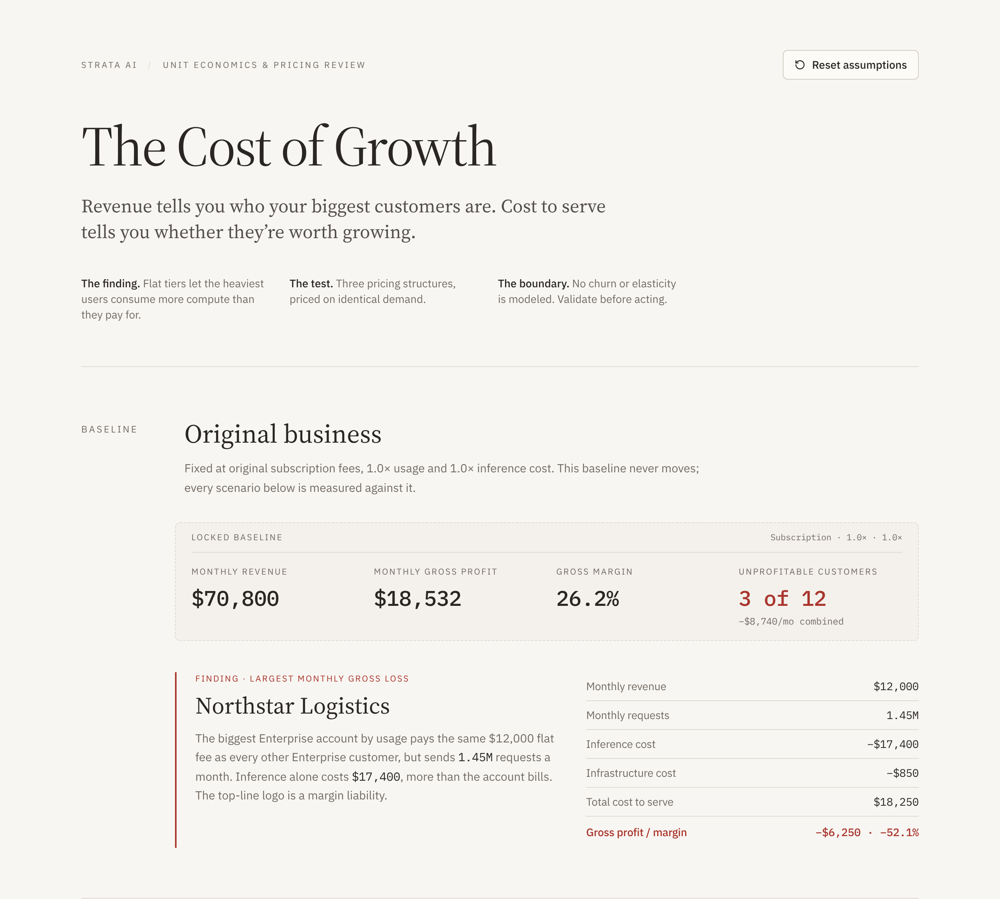
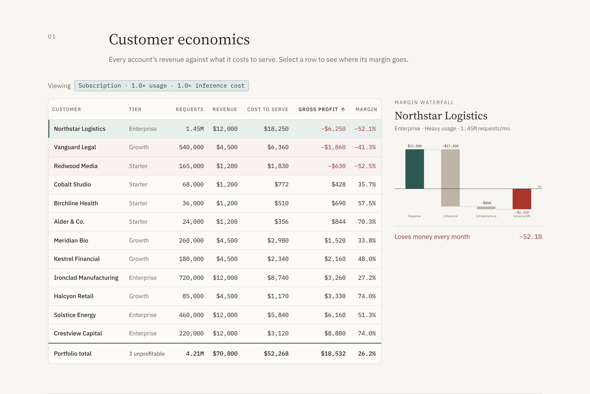
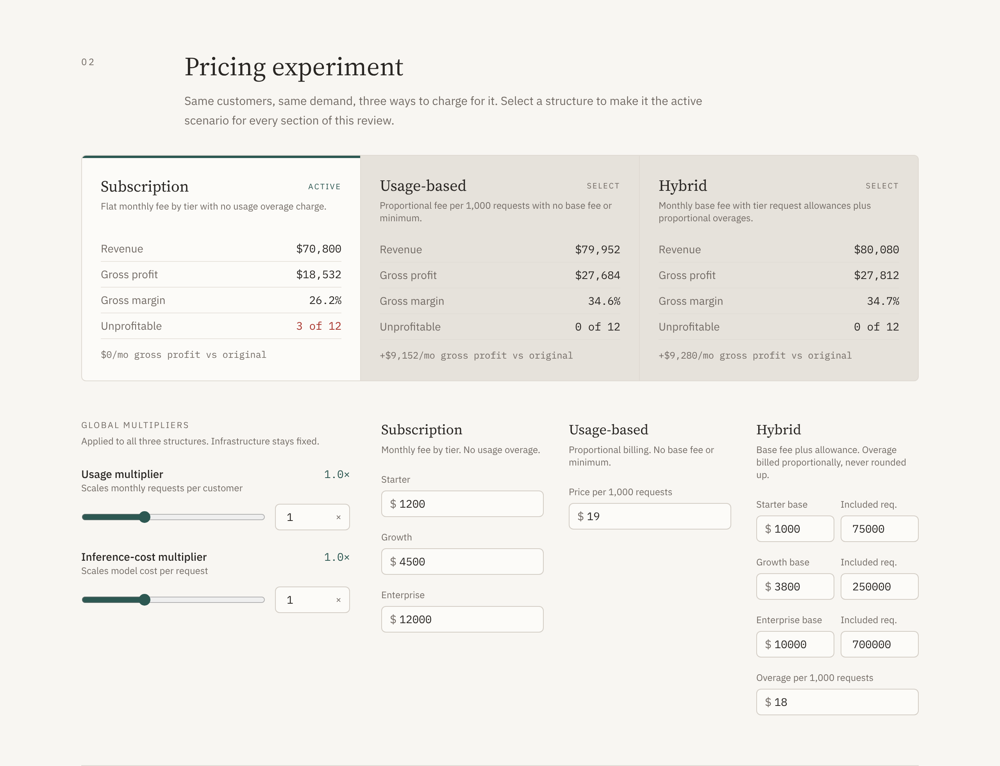

# The Cost of Growth

**An interactive unit-economics and pricing model for a fictional AI software company.**

**Live site: [cost-insights.replit.app](https://cost-insights.replit.app)**

Revenue tells you who your biggest customers are. Cost to serve tells you whether they're worth growing. This app takes a 12-customer AI business on flat subscription tiers and shows which accounts actually lose money once inference costs are counted. It then reprices the same customers under subscription, usage-based and hybrid pricing. Built as a rapid prototype on Replit.



## What it shows

- **Original business.** A locked baseline: $70,800 monthly revenue, $18,532 gross profit and a 26.2% gross margin, with 3 of 12 customers unprofitable. The largest monthly loss is an Enterprise account that pays $12,000 and costs $18,250 to serve.
- **Customer economics.** A sortable table of revenue, requests, cost to serve and margin for every account. Selecting a row opens a margin waterfall that handles negative gross profit.
- **Pricing experiment.** Edit the tier prices, the usage rate and the hybrid allowances and overage. Global multipliers for usage and inference cost stress-test all three structures side by side.
- **Who pays more?** Each customer's new bill compared with their original subscription fee, with large increases flagged for review.
- **Finance takeaway.** A written summary generated from the current inputs. It names the most profitable structure, who pays more, which accounts are still unprofitable and what the model can't tell you.
- **Assumptions & methodology.** Every formula and default stated plainly in a collapsible panel.





## How the model works

- **Requests** = original monthly requests × usage multiplier
- **Inference cost** = requests × cost per request × inference-cost multiplier
- **Cost to serve** = inference cost + fixed infrastructure
- **Gross profit** = revenue − cost to serve; **gross margin** = gross profit ÷ revenue

Cost is calculated the same way under every pricing structure, so the only thing that changes between scenarios is revenue. Customer count and demand stay fixed: the model deliberately doesn't invent churn, conversion or price elasticity, and it says so in the takeaway.

All calculations run in the browser at full precision and are rounded only for display. The baseline dataset is frozen, so scenario edits never change the reference numbers. The model lives in a single file: [`artifacts/cost-of-growth/src/lib/financeModel.ts`](artifacts/cost-of-growth/src/lib/financeModel.ts).

## Stack

React 19, TypeScript, Vite, Tailwind CSS v4 and Recharts, in a pnpm workspace. It's a static, client-only site with no backend, database, login or external APIs. Built on [Replit](https://replit.com).

## Run locally

Requires Node.js 22+ and pnpm.

```bash
pnpm install
PORT=5173 BASE_PATH=/ pnpm --filter @workspace/cost-of-growth run dev
```

Typecheck and production build:

```bash
pnpm run typecheck
PORT=5173 BASE_PATH=/ pnpm --filter @workspace/cost-of-growth run build
```

The build output goes to `artifacts/cost-of-growth/dist/public`.

## Disclaimer

Strata AI and all of its customers are fictional. Any resemblance to real companies is coincidental, and all figures are illustrative.

## License

[MIT](LICENSE)
